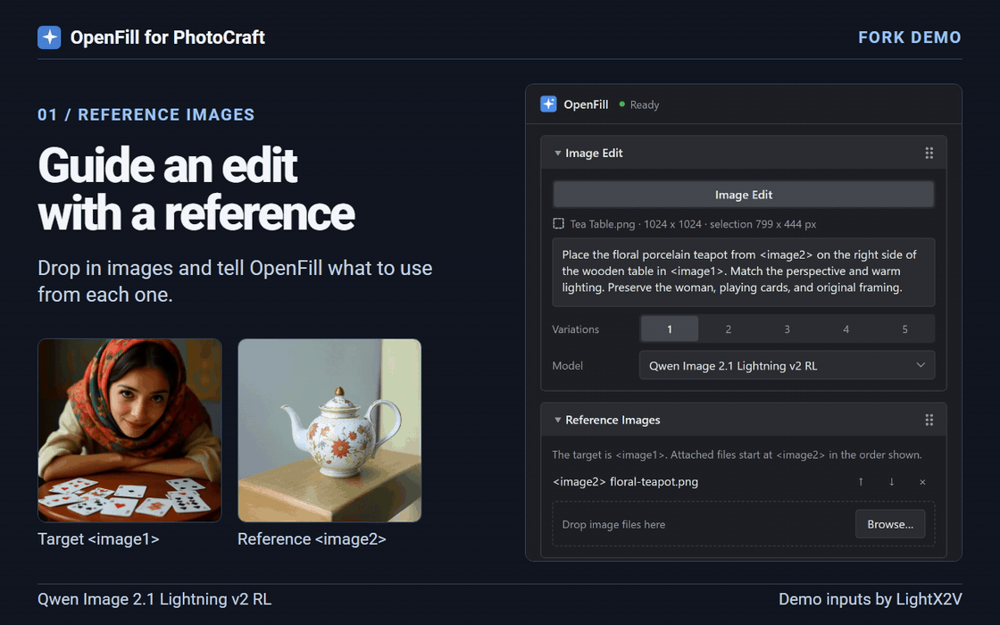

<div align="center">

# OpenFill for PhotoCraft

[](LICENSE) 

*Generative fill, reference-guided image editing, object removal, expand, and text-to-image with ComfyUI.*

**[Download OpenFill for PhotoCraft](https://github.com/Omegadarling/openfill/releases/latest)** · [Setup and model guide](photocraft/README.md)

<br>
**Add a reference, review the edit, and arrange the OpenFill panel.**<br>
<sub>Screenshot walkthrough with a saved Qwen Lightning edit and <a href="https://huggingface.co/lightx2v/Qwen-Image-2.1-Lightning-v2-RL#multi-reference-generation-1">demo inputs from LightX2V</a>.</sub>

</div>

This fork extends [Beckett Harriman’s OpenFill](https://github.com/beckettharriman/openfill) for PhotoCraft. The original GIMP plug-in and its installation instructions are available upstream.

## What this fork adds

- **Remove without a prompt.** Select the object and its shadow and open **Remove**. **Suggest for** picks a method for the scene, or choose **Method** yourself. Start with Local for a smooth backdrop, LaMa for wires and repeated detail, RORem for reflective objects, or Qwen Image 2.1 Lightning for hidden shapes. The panel lists methods available on your selected source.
- **Image Edit** with full Qwen Image 2.1 BF16, four-step Qwen Image 2.1 Lightning v2 RL, and compatible FIBO 2.0 Edit Turbo and Dev NVFP4 checkpoints on an existing ComfyUI server.
- **Multiple reference images** for Qwen 2.1 and FIBO 2.0. Add and reorder references, then use their labels in the prompt. Drag image files in from Explorer on Windows or drop them into the browser panel.
- **Automatic feathering** softens the mask inward so an edit blends into the original along the selection edge.
- **FIBO 2.0 context controls** give the model either the full image or an adjustable crop around the selection. The selection still controls where the edit appears. Optional boundary color matching helps blend it into the original.
- **One rearrangeable panel.** Expand or collapse sections for editing, references, models, engine settings, and generation. Drag the section grips to reorder them. OpenFill remembers your layout and which models you show in the dropdown. Generation changes apply to the next accepted job and are saved for later.
- **Compare more variations.** Click **Generate** again in Image Edit or Fill on the same document to add to the choices already shown. **Keep**, **Keep all**, and **Discard** sit below the thumbnails.

The managed engine also supports the original tools.

<table>
<tr><td><b>Fill with a prompt</b></td><td>Select, type "a red door with brass handles", Enter. The fill lands on a new layer with a soft mask.</td></tr>
<tr><td><b>Remove object</b></td><td>Select, press Remove. No prompt. It erases the selection at your image's own resolution.</td></tr>
<tr><td><b>Generative Expand</b></td><td>Drag the canvas edges outward or pick a ratio, and it paints the new border. The prompt is optional.</td></tr>
<tr><td><b>Create</b></td><td>A new image or a new layer from a prompt, sized to the selection if there is one.</td></tr>
</table>

Results always go on new layers, in one undo step, so your existing layers are never painted over. In PhotoCraft it's a panel next to your image (and `Filter > Plug-ins > OpenFill`); in GIMP it's under `Filters > OpenFill`.

## Where generation runs

The managed engine runs ComfyUI locally for Fill, Remove, Expand, and Create. **Image Edit** connects to a ComfyUI server you run yourself, either on the PhotoCraft computer or on another computer on your LAN.

For a LAN server, start ComfyUI on that computer and run this in a terminal on the PhotoCraft computer. Replace `your-user` and `192.168.1.50` with your SSH username and the ComfyUI computer’s LAN address.

```sh
ssh -N -o ExitOnForwardFailure=yes -L 127.0.0.1:8188:127.0.0.1:8188 your-user@192.168.1.50
```

Leave the tunnel open. Enable existing-server mode and choose **Local ComfyUI** in OpenFill. It connects through `127.0.0.1:8188`, and the tunnel carries the edit to the other computer. [LAN setup and connection checks](photocraft/README.md#connect-to-comfyui-on-your-lan) · [Existing-server settings](photocraft/README.md#edit-with-an-existing-comfyui)

## Install

Install on Windows 10 or 11, Linux, or Apple Silicon macOS. For the standard tools, 8 GB of graphics memory covers many SDXL and FLUX configurations, and LaMa and SD 1.5 can use less. Qwen 2.1 and FIBO require a compatible ComfyUI server and more memory. On Windows, the managed engine can download ComfyUI for NVIDIA or AMD cards. [Platform instructions](photocraft/README.md#what-you-need)

1. Install PhotoCraft. You can [reuse ComfyUI's Python](photocraft/README.md#use-comfyuis-python), or install Python from [python.org](https://www.python.org/downloads/) if you need it.
2. Download the `openfill-photocraft-*.zip` installer from the [fork’s latest release](https://github.com/Omegadarling/openfill/releases/latest). Unzip it and run **Install OpenFill for PhotoCraft.cmd** on Windows or `sh install.sh` on Linux or macOS.
3. Open **PhotoCraft with OpenFill**. For the standard tools, set up the managed engine and use **Manage Models** to install models. For Qwen 2.1 or FIBO 2.0, follow the [existing ComfyUI setup](photocraft/README.md#edit-with-an-existing-comfyui).

## Models

Install models on the computer running ComfyUI. The two engine modes support different workflows.

| Engine | Models |
| --- | --- |
| **Existing ComfyUI** for Image Edit | Qwen Image 2.1 Full BF16 and four-step Lightning v2 RL. FIBO 2.0 Edit Turbo and Dev Edit NVFP4. Existing-server SDXL editing requires a verified checkpoint entry. The public install ships with an empty SDXL registry for this mode. |
| **Managed ComfyUI** for Fill, Remove, Expand, and Create | SDXL (including RealVisXL V5 and Juggernaut XL v9), SD 1.5 inpainting (including DreamShaper 8), FLUX.1 Fill, Qwen Image Edit 2511 GGUF, and removal models such as LaMa, MAT, and RORem. Available tools depend on the model. |

[Existing-server model files](photocraft/README.md#existing-server-models) · [Managed model catalog](photocraft/README.md#managed-engine-models)

| Job | Default model | Graphics memory | Time (RTX 4070 Laptop) |
|---|---|---|---|
| Remove object | LaMa (RORem and a FLUX eraser to compare) | 2 GB | about 5 s |
| Fast fill | DreamShaper 8 Inpainting | 4 GB | about 9 s |
| Quality fill | RealVisXL V5 with the Fooocus inpaint patch | 8 GB | 20 to 45 s |

Each model has its own license. MAT and the FLUX.1 Fill models are **non-commercial**. Details in [docs/models.md](docs/models.md).

## Status

Where it still falls short:

- **FLUX and Qwen fills, Expand and Create work at about 1024 px** and are scaled up, so on big images they come back softer. Remove is not affected.
- **SD 1.5 often ignores the prompt** on flat areas and small selections. Pick an SDXL model.
- **FLUX on 8 GB is slow.**

PhotoCraft changes are in the [companion changelog](photocraft/CHANGELOG.md).

## Where it came from

OpenFill started as a GIMP 3 port of [Torben Giesselmann's GIMP plug-in](https://github.com/thndrbrrr/gimp-stable-boy). The backend is [ComfyUI](https://github.com/comfyanonymous/ComfyUI). Acly's [comfyui-inpaint-nodes](https://github.com/Acly/comfyui-inpaint-nodes) do the inpainting, and his [krita-ai-diffusion](https://github.com/Acly/krita-ai-diffusion) was the reference for how to build the graphs and manage the server. OpenFill is not affiliated with PhotoCraft.

Open, as in open source and on your own machine. Fill, as in the thing everyone else rents you by the month.

## License

[Apache-2.0](LICENSE) © 2026 Beckett Harriman.
