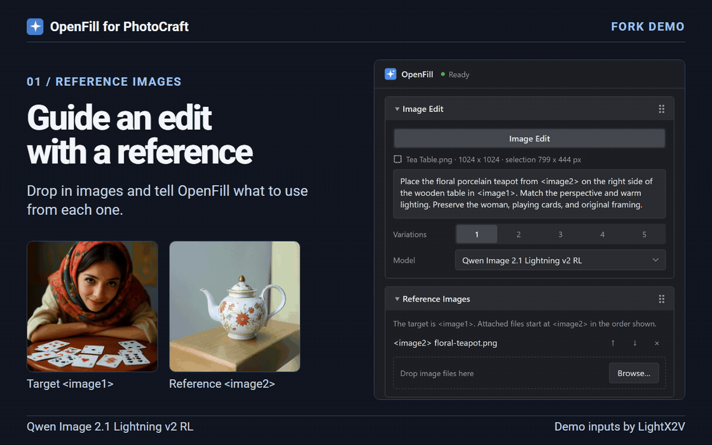

# OpenFill for PhotoCraft

Select, edit, and remove objects in [PhotoCraft](https://github.com/storytold/photocraft), using [ComfyUI](https://github.com/comfyanonymous/ComfyUI).

**[Download the latest PhotoCraft installer](https://github.com/Omegadarling/openfill/releases/latest).** Choose the `openfill-photocraft-*.zip` asset and follow the instructions below for your platform.

The standard tools share the engine from [upstream OpenFill](https://github.com/beckettharriman/openfill). This fork adds reference-guided editing with Qwen Image 2.1 and FIBO 2.0, a single rearrangeable settings panel, and the ability to add to a set of pending variations.

## Select an object

Open **Filter → Plug-ins → OpenFill**, then choose **Select**. Click inside an object in the panel preview, or drag a tight box around a small or overlapping object. Release to select its outline. Escape cancels the drag. Blue shows the selection. You can also enter **the teaspoon beside the cup** and press **Select by description**. A description can narrow a click or a box to the part you want.

Use **Add** to include another object or **Subtract** to take one out. Set **Grow selection** to the number of document pixels to expand (1–64, initially 4), then press **Grow**. Press it again for another expansion. Grow also works with a PhotoCraft lasso or marquee, even without ComfyUI. Each operation has its own Undo step. Switch straight to **Edit** or **Remove** to use the selection.

**AI setup:** use a ComfyUI build with the built-in [WeVisOne-VL Detect node](https://github.com/Comfy-Org/ComfyUI/pull/17632). Put one of the [Comfy-Org WeVisOne-VL encoders](https://huggingface.co/Comfy-Org/WeVisOne-VL/tree/135355350443103e34089dd39264fe0651691929/text_encoders) in that server's `models/text_encoders` folder. Use the ComfyUI conversion, which includes the mask decoder. The 4B BF16 file is 9.7 GB; 2B and INT8 files are also supported. OpenFill discovers the file by its loader name. These weights are optional and are not part of the OpenFill download.

## Use a different engine for each mode

By default **Select**, **Edit** and **Remove** share the configured engine. Open **Engine**, check **Multi-engine**, and choose a ComfyUI server for each mode. Choose **Other ComfyUI URL…** to enter another server address or a local forwarded port. Two modes can share a server. Assignments save immediately and are remembered when you turn Multi-engine back on. **Check** tests the engine for the current mode.

Start the selected ComfyUI servers and install each model on the server assigned to its mode. After the first use, switching tabs leaves the servers running so ComfyUI can reuse loaded models as its GPU memory permits. Separate GPUs give each mode its own memory. Grow and Local removal run inside PhotoCraft.

An existing `selection-engine.json` adds **Local WeVisOne** to the Select picker. It specifies `port`, absolute paths to `python`, `comfy_dir` (contains `main.py`) and `data_dir` (contains `models`), and an optional `cuda_device` index. Choosing this helper in Multi-engine starts it on demand. When Multi-engine is off, Select uses the shared server even if this file exists.

## Edit with an existing ComfyUI

1. Install the [compatible model files](#existing-server-models) on the computer running ComfyUI. For the same computer as PhotoCraft, start ComfyUI on `127.0.0.1:8188`. For another computer, [open an SSH tunnel](#connect-to-comfyui-on-your-lan) before launching OpenFill.
2. Open **PhotoCraft with OpenFill** once to create the profile, then close it. In the profile’s `openfill/config.json`, set `"remote_fibo": true` and `"fibo_source": "local"`, keeping the other settings. If the file is missing, create the `openfill` folder inside the profile and save this as `config.json`. See [Good to know](#good-to-know) for the profile location.

   ```json
   {
     "remote_fibo": true,
     "fibo_source": "local"
   }
   ```

3. Reopen **PhotoCraft with OpenFill**. In **Engine**, use **Local ComfyUI** and press **Check**. This source uses `127.0.0.1:8188` for both a local server and a tunnel. Select the area to edit and choose a model in **Edit**. Use **Select All** when you want the edit to cover the whole image.

If the connection succeeds and your model is missing, check that the server sees the required files and nodes and that the model is enabled in **Manage Models**. To return to the managed engine and its Fill, Remove, Expand, and Create modes, set `"remote_fibo": false` while the companion is closed.

### Remove an object

1. Lasso the whole object, its shadow or reflection, and a narrow margin of background. Leave some unselected background for OpenFill to sample.
2. Open **Remove**. **Automatic from selection** reads the size of the selection and samples colors, edges and texture in the visible composite. The panel shows the suggested **Method** and a reason. Sampling happens locally. Redraw the selection to get a fresh suggestion.
   You can choose a **Method** yourself or pick a situation in **Suggest for**. Choose **Automatic from selection** to resume automatic suggestions.
3. Choose **Variations** (1–5), press **Remove**, then click each result thumbnail to compare it on the canvas. You can also run another method on the same selection to add alternatives.
4. Choose **Keep** under the result you want, or **Discard** to return to the original.

Remove adds a small, softly blended margin around the selection to clear outlines. The original selection stays available. Include cast shadows in the selection when they should be removed too. Local tries different ways to continue the surrounding light or texture. On a patterned backdrop with similar colors around the lasso, Local limits its texture samples to matching background patches. This helps keep a nearby person or other object out of the repair. If several attempts produce identical visible pixels, the panel shows one copy and tells you how many distinct repairs it found.

| Situation | Method to try | What the comparison showed |
| --- | --- | --- |
| Smooth studio backdrop | Local background repair | Continued the lighting behind a character and a bottle. Works offline. |
| Wires, paving or small clutter | LaMa (Big-LaMa) | Removed a cable across a launch pad and continued paving joints. |
| Reflective object on overlapping surfaces | RORem (SDXL removal) or LaMa | Both removed a spoon from a cup and saucer. |
| Missing recognizable shape | Qwen Image 2.1 Lightning | Reconstructed a plausible wheel and a cat's eye. Other scenes retained the object or showed artifacts. |
| Water and surface bubbles | Rebuild background (FIBO Dev) | Continued bubbles behind a diver. Inspect for invented details or a visible boundary. |
| Covered lettering | Original artwork or retyping | All tested models changed or lost letters beneath an opaque label. |

Automatic advice samples the rectangular extent of a lasso and the nearby background. The removal itself uses the full selection mask. The samples describe visible lighting and texture. For a recognizable hidden feature or lettering, the situation menu lets you supply that context.

**Existing ComfyUI servers.** The chooser checks the selected server. For Big-LaMa, install [ComfyUI-RMBG](https://github.com/1038lab/ComfyUI-RMBG) there. Its LaMa Remover uses `models/RMBG/Lama/big-lama.pt` and can download the roughly 206 MB checkpoint on first use. LaMa keeps the normal repair first. For additional choices, it processes the same image and mask from different orientations and aligns each result back to the canvas. For [RORem](https://huggingface.co/LetsThink/RORem/tree/22d02de974c8dc92c717cd3431f8b0fe0eeecc3b), use these loader names. Subfolders are supported.

| Downloaded file | ComfyUI model path |
| --- | --- |
| `unet/diffusion_pytorch_model.safetensors` | `models/diffusion_models/RORem-unet.safetensors` |
| `text_encoder_2/model.safetensors` | `models/text_encoders/RORem-clip-g.safetensors` |
| `vae/diffusion_pytorch_model.safetensors` | `models/vae/RORem-sdxl-vae.safetensors` |
| Standard [CLIP-L](https://huggingface.co/comfyanonymous/flux_text_encoders/blob/main/clip_l.safetensors) | `models/text_encoders/clip_l.safetensors` |

Qwen removal uses the four-step Lightning model described above with the original image and a second copy highlighting the selection. FIBO removal uses Dev with its original encoder and a locally repaired guide. If its reconstruction differs sharply from that guide, OpenFill returns the local repair and identifies the fallback in the job notice. **Manage Models** controls visibility. The managed engine retains its existing removal choices.

### Connect to ComfyUI on your LAN

1. On the ComfyUI computer, start ComfyUI on `127.0.0.1:8188`. That computer needs a running SSH server that accepts your login and allows local port forwarding. Keep ComfyUI bound to loopback.
2. On the **PhotoCraft computer**, open a terminal and run the command below. Replace `your-user` with your SSH account and `192.168.1.50` with the ComfyUI computer’s LAN IP address or hostname. Leave the terminal open while you work.

   ```sh
   ssh -N -o ExitOnForwardFailure=yes -L 127.0.0.1:8188:127.0.0.1:8188 your-user@192.168.1.50
   ```

3. On the PhotoCraft computer, open `http://127.0.0.1:8188/system_stats` in a browser. A JSON response confirms that ComfyUI answers through the tunnel. Launch OpenFill with the existing-server settings above, keep **Local ComfyUI** selected, and use **Engine → Check**.

The public build uses local port `8188` for this connection. If another local ComfyUI or tunnel is using it, free that port before opening the new tunnel. If ComfyUI uses a different port on the other computer, change the last `8188` in the `-L` argument. Press Ctrl+C in the SSH terminal to disconnect after your edits finish. The server processes the image data, mask, prompt, and references you send for the job. [OpenSSH port forwarding](https://man.openbsd.org/ssh#L) · [ComfyUI server routes](https://docs.comfy.org/development/comfyui-server/comms_routes)

Custom builds can register additional named backends in [`sources.py`](https://github.com/Omegadarling/openfill/blob/main/gimp-openfill/openfill/sources.py) and use their registered IDs in `fibo_source`.

## Existing-server models

Edit discovers the supported Qwen and FIBO checkpoints when their companion weights and nodes are available. Use the [managed model catalog](#managed-engine-models) for the original Fill, Remove, Expand, and Create tools.

### Qwen Image 2.1

Qwen 2.1 uses `qwen3vl_8b_fp8_scaled.safetensors` in `models/text_encoders` and `qwen_image_2.1_vae_bf16.safetensors` in `models/vae`. Put one or both diffusion checkpoints in `models/diffusion_models`.

| Model | Diffusion filename | Sampler |
| --- | --- | --- |
| Qwen Image 2.1 | `qwen_image_2.1_bf16.safetensors` | 25 Euler steps at CFG 1 |
| Qwen Image 2.1 Lightning v2 RL | `qwen_image_2.1_lightning_v2_rl_bf16.safetensors` | Four Euler steps using the published sigma schedule |

The Qwen Image 2.1 release provides the full BF16 model and VAE. The encoder comes from the Comfy-Org Qwen3-VL release. ComfyUI needs the native `TextEncodeQwenImage21` and `QwenImage21Cache` nodes. [Model files](https://huggingface.co/Comfy-Org/Qwen-Image-2.1) · [Encoder files](https://huggingface.co/Comfy-Org/Qwen3-VL) · [ComfyUI guide](https://docs.comfy.org/tutorials/image/qwen/qwen-image-2-1)

For Lightning v2 RL, download the pinned full FP32 transformer and convert it with the optional conversion script from the source repository. Run the script with a Python environment that has NumPy, such as the ComfyUI virtual environment. [LightX2V model and license](https://huggingface.co/lightx2v/Qwen-Image-2.1-Lightning-v2-RL/tree/682b2529ffb5ae9ba39ceb81a31ce99e602da2ee) · [Conversion script](https://github.com/Omegadarling/openfill/blob/main/tools/convert_qwen21_lightning.py)

```text
python tools/convert_qwen21_lightning.py diffusion_pytorch_model.safetensors qwen_image_2.1_lightning_v2_rl_bf16.safetensors
```

Both Qwen variants return a masked layer and preserve pixels outside the selection. Leave room in the selection for inserted objects and their shadows. A tight selection can clip the generated object.

### FIBO 2.0

Use a ComfyUI build that exposes `TextEncodeFibo2` and supports the `fibo2` CLIP loader and NVFP4 checkpoints. Put `qwen3vl_4b_bf16.safetensors` in `models/text_encoders` and `flux2-vae.safetensors` in `models/vae`. Put `fibo2_edit_turbo_nvfp4.safetensors`, `fibo2_dev_nvfp4.safetensors`, or both in `models/diffusion_models`. The optional `qwen3_vl_4b_nvfp4_full.safetensors` encoder adds Heretic choices alongside Original in the model dropdown. [Encoder and VAE](https://huggingface.co/Comfy-Org/Fibo-2.0) · [Edit Turbo checkpoint](https://huggingface.co/BennyDaBall/Fibo-2.0-edit-turbo-NVFP4) · [Dev checkpoint](https://huggingface.co/BennyDaBall/Fibo-2.0-dev-NVFP4)

In **Generation**, choose **Surrounding area** to give FIBO an adjustable crop around the selection, or **Full image** when the rest of the scene matters to the edit. The selection controls where PhotoCraft displays the generated layer in either case. Use **Preserve structure** to retain more of the original form, or **Replace selected content** for a larger change. Optional boundary color matching adjusts colors near the selection edge to help the edit blend in.

### SDXL

For SDXL out of the box, use the [managed engine](#managed-engine-models). Edit on an existing ComfyUI also supports verified full SDXL checkpoints with 4-channel base or 9-channel inpainting architectures. The public build’s registry starts empty. To add a checkpoint in a custom build, audit the SafeTensors header, verify the sampling workflow, and register the exact ComfyUI loader path and source ID. For the public loopback connection, including a LAN tunnel, the source ID is `local`. SDXL uses prompt and selection editing. Reference attachments are available with Qwen 2.1 and FIBO 2.0. [Registry](https://github.com/Omegadarling/openfill/blob/main/gimp-openfill/openfill/verified_sdxl.json) · [Registry format and validation](https://github.com/Omegadarling/openfill/blob/main/gimp-openfill/openfill/remote_sdxl.py)

### Reference images and panel layout

Choose a reference-capable model and use **Reference Images** to attach up to 15 PNG, JPEG, or WebP files. Drop files onto the reference drop area in the Windows panel or browser view, or click **Add reference images** to choose them. The target document is image 1. In a Qwen prompt, use `<image2>`, `<image3>`, and so on for the attachments. FIBO uses `<image_2>`, `<image_3>`, and so on. The reference list shows the current labels and supports reordering and removal. Attachments are kept for the current companion session.

Open **Manage Models** to control which models appear in the main dropdown. Click a section header to expand or collapse it, or drag its grip to move the section. OpenFill saves the section order, collapsed state, and model visibility in your profile.

Changes in **Generation** apply when you click **Generate** or press Enter in the prompt. OpenFill saves those choices once it accepts the job.

**Auto-feather selection** in **Generation** softens the layer mask inward, so the transition blends into the original along the selection edge. Adjust **Auto-feather area (%)** to control the amount. Pixels outside the selection stay untouched.



Screenshot walkthrough with a saved Qwen Lightning edit. [Demo inputs from LightX2V](https://huggingface.co/lightx2v/Qwen-Image-2.1-Lightning-v2-RL#multi-reference-generation-1)

## What you need

- **PhotoCraft** from its [releases page](https://github.com/storytold/photocraft/releases). The upstream companion documented compatibility with PhotoCraft 0.12 to 0.16.
- **Windows 10 or 11, Linux, or macOS on Apple Silicon.**
- **A GPU supported by ComfyUI**. 8 GB is enough for many standard SDXL and FLUX workflows. LaMa (Remove) and SD 1.5 can use less. The Qwen 2.1 and FIBO weights have higher memory and disk requirements. [AMD graphics cards](https://github.com/beckettharriman/openfill/blob/main/docs/install.md#amd-graphics-cards)
- **ComfyUI.** On Windows the OpenFill panel downloads it for you the first time (a 1.9 GB download, 6.7 GB unpacked; the version for AMD cards is 1.6 GB). If you use OpenFill for GIMP, the same ComfyUI is found by itself.
- **Python 3.10 or newer with Pillow.** You can use ComfyUI's existing Python on Windows, macOS or Linux without installing another one. Tk is optional: with it, you get a separate OpenFill panel; without it, you get a tab in your default browser.
- **Disk space** for the models. LaMa is about 0.2 GB. The largest checkpoints and their encoders can need tens of gigabytes.

## Install on Windows

1. Install PhotoCraft (the `.msi`).
2. If you already have ComfyUI, you can use its Python without installing another one; see [using ComfyUI's Python](#use-comfyuis-python). Otherwise, install Python from [python.org](https://www.python.org/downloads/windows/).
3. Unzip the [fork installer](https://github.com/Omegadarling/openfill/releases/latest) and double-click **Install OpenFill for PhotoCraft.cmd**. It adds **PhotoCraft with OpenFill** to the Start menu and the desktop.
4. Open **PhotoCraft with OpenFill**. PhotoCraft opens with the OpenFill panel next to it.
5. For the managed engine, the panel asks for what's missing:
   - **AI engine not found**: press **Download ComfyUI**. It downloads and unpacks in the background (a few minutes) into `%LOCALAPPDATA%\OpenFill\ComfyUI`. With an AMD card it gets ComfyUI's version for AMD cards. If you already have ComfyUI, press **Choose folder** instead and pick the folder that has `main.py` in it (or the portable folder).
   - **No models installed**: press **Open model manager**. LaMa (removing things, 0.2 GB) and DreamShaper 8 Inpainting (fill, expand and create, 2 GB) cover every tool.

Open the **Manage Models** section to manage available models. The **Open model manager** button on the first run also opens that section.

If the selected Python has no Tk, the OpenFill panel opens in a tab in your default browser. PhotoCraft stays in its own window. No browser is installed or chosen for you. See [using ComfyUI's Python](#use-comfyuis-python).

To remove it, run `Install OpenFill for PhotoCraft.cmd --uninstall` from a command prompt in the unzipped folder. PhotoCraft stays installed, and your settings and models stay where they are.


## Use ComfyUI's Python

You do not need a second Python installation. OpenFill can run in ComfyUI's Python environment on Windows, macOS and Linux. It needs Python 3.10 or newer and Pillow, which ComfyUI normally already has. Selecting this interpreter does not change ComfyUI's packages.

Open a terminal in the unzipped OpenFill folder. Set the path to the Python you already use for ComfyUI, then run the installer.

Windows portable ComfyUI, in **Command Prompt**:

```bat
set "OPENFILL_PYTHON=C:\ComfyUI_windows_portable\python_embeded\python.exe"
"Install OpenFill for PhotoCraft.cmd"
```

macOS or Linux, for example:

```sh
OPENFILL_PYTHON="$HOME/ComfyUI/.venv/bin/python" sh install.sh
```

Change the example path to match your installation. A virtual environment may be named `venv` instead of `.venv`; Windows virtual environments use `Scripts\python.exe`. Paths with spaces work. The launcher remembers the chosen Python. If you move or remove that environment, rerun the installer with its new path.

With Tk available, OpenFill shows its separate panel. Without Tk, it opens the same controls in a normal tab in your default browser on all three platforms. The page runs locally. Keep PhotoCraft open while using it. To try this without installing launchers on macOS or Linux, set the same variable and run `sh openfill-photocraft.sh`.

### After updating PhotoCraft

The launcher looks for PhotoCraft each time it starts, rather than storing a version number. An update in the usual installed location should be found automatically. OpenFill keeps its ComfyUI folder setting and models separate from the PhotoCraft installation. Explicit `--photocraft` or `PHOTOCRAFT_BIN` paths take priority. Portable copies, moved apps or old symlinks may still point to an older version, so keep one intended copy in the standard location or update that explicit path. A future PhotoCraft API change may still need an OpenFill update; automatic discovery is not a compatibility guarantee.

## Install on Linux

1. Unzip the [fork installer](https://github.com/Omegadarling/openfill/releases/latest) and run `sh install.sh` in the unzipped folder.
   - No PhotoCraft yet? The installer offers to download it for you (the official Linux build, SHA-256 checked, no admin rights).
2. Open PhotoCraft the usual way: from the app menu, or by opening an image in the file manager. OpenFill comes with it.
3. For the managed engine, choose your ComfyUI folder or follow ComfyUI's [manual install](https://github.com/comfyanonymous/ComfyUI#manual-install-windows-linux), then use **Open model manager** to install models. [AMD on Linux](https://github.com/beckettharriman/openfill/blob/main/docs/install.md#amd-on-linux)

The installer gives PhotoCraft's menu entry to OpenFill (a copy in `~/.local/share/applications` that starts PhotoCraft through OpenFill). If you'd rather keep them apart, run `sh install.sh --separate-icon` and use "PhotoCraft with OpenFill" instead.

To remove it: `openfill-photocraft-uninstall`. Your settings and models stay.

## Install on macOS

The upstream installer was tested with PhotoCraft 0.16.0 on an M3 MacBook Air. [Upstream test results](https://github.com/beckettharriman/openfill/tree/main/docs/evidence/macos-photocraft-2026-10-26)

1. Install PhotoCraft from its [macOS DMG](https://github.com/storytold/photocraft/releases) in `/Applications` or `~/Applications`.
2. Install Python 3.10 or newer from [python.org](https://www.python.org/downloads/macos/), which includes Tk, then run `python3 -m pip install Pillow`. You can instead use your existing ComfyUI Python with Pillow; Tk is optional. See [using ComfyUI's Python](#use-comfyuis-python).
3. Set up ComfyUI using the [Mac engine steps](https://github.com/beckettharriman/openfill/blob/main/docs/install.md#macos), or use your existing ComfyUI and models.
4. Unzip the [fork installer](https://github.com/Omegadarling/openfill/releases/latest) and run `sh install.sh` from the unzipped folder.
5. Open `~/Applications/PhotoCraft with OpenFill.app`. For the managed engine, use **Engine** to choose your ComfyUI folder and **Manage Models** to install models such as LaMa and DreamShaper 8.

The panel floats independently; following PhotoCraft when it moves or minimizes is Windows-only. To remove OpenFill, open `~/Applications/Uninstall OpenFill for PhotoCraft.app`, or run `sh install.sh --uninstall`. PhotoCraft, settings and models stay.

## Using it

Make a selection in OpenFill's Select mode or in PhotoCraft. In Edit, type the change you want and press Enter. You can also pick **Filter > Plug-ins > OpenFill** in PhotoCraft to bring the panel back.

| Mode | What it does |
|---|---|
| Select | Click or describe an object, add or subtract matches, or grow the current selection. |
| Edit | Edits the selected region on an existing ComfyUI. Attach references with Qwen 2.1 or FIBO 2.0, or use a verified SDXL checkpoint for a prompt-based selection edit. |
| Edit → Fill | Fills the selection from your prompt, or from the surroundings with no prompt. Up to 5 variations. |
| Remove | Fills an object's selection from nearby texture or reconstructs the background with FIBO on an existing server. Managed mode also offers LaMa and its other installed removers. |
| Edit → Expand | Grows the canvas: drag the frame's edges, or pick a ratio (Original adds 25 % on each side; 1:1, 5:4, 4:3, 3:2 and 16:9, landscape or portrait). It paints the new edges. |
| Edit → Create | Text to Image as a new image (square, landscape or portrait), or as a layer in the open image. With a selection, the layer fills the selection. |

While it works you see a live preview. Click the result thumbnails to compare the edits in PhotoCraft. In Edit, click **Generate** again on the same document to add to the pending choices. The earlier choices stay visible while the new batch runs. Use **Keep**, **Keep all**, or **Discard** directly below the thumbnails to resolve the set.

Every generated image result is a new layer with a mask (variations go into a group), and it is **one step** in PhotoCraft's history: one Undo takes a fill or a whole expand back. Keep leaves it one step, and Discard takes it back completely. Your selection stays as it was, and the clipboard is never touched.

The panel stays with PhotoCraft and hides when PhotoCraft is minimized. The arrow at its top right folds it into a small strip. Expand **Manage Models** to manage model files, **Engine** for ComfyUI settings, or **Generation** for generation settings.

In managed mode, OpenFill starts ComfyUI in the background and stops it when PhotoCraft closes. In existing-server mode, you control the ComfyUI process.

## Managed engine models

The model manager shows what fits your graphics card. Each model has its own license; the model manager links to it. On an AMD card it marks the GGUF models (FLUX.1 Fill GGUF, Qwen Image Edit), which have been reported to give only noise on some Radeon cards.

| Model | Size | For | License |
|---|---|---|---|
| LaMa | 0.2 GB | Remove (default) | Apache-2.0 |
| MAT Places512 | 0.1 GB | Remove | **CC BY-NC 4.0, non-commercial** |
| RORem (SDXL eraser) | 6.5 GB | Remove | Apache-2.0 |
| FLUX.1 Fill object removal LoRA | 0.3 GB, on FLUX.1 Fill | Remove | MIT for the LoRA, but it runs on FLUX.1 Fill: **non-commercial** |
| DreamShaper 8 Inpainting | 2.0 GB | Fill, Expand, Create | CreativeML OpenRAIL-M |
| SD 1.5 Inpainting, Realistic Vision V6 Inpainting | 4.0 / 2.0 GB | Fill, Expand, Create | CreativeML OpenRAIL-M |
| RealVisXL V5, Juggernaut XL v9, SDXL base (with the Fooocus inpaint patch, 1.2 GB) | 6.5 GB each | Fill, Expand, Create | CreativeML OpenRAIL++-M / OpenRAIL-M |
| FLUX.1 Fill dev (GGUF Q4, GGUF Q6, full) | 10 to 27 GB | Fill, Expand | **FLUX.1 [dev] Non-Commercial License** |
| Qwen Image Edit 2511 (GGUF Q4) | 21 GB | Fill, Expand | Apache-2.0 |

The managed engine also scans your own model files. Put compatible SD 1.5 inpainting or 4-channel SDXL `.safetensors` checkpoints in `models/checkpoints`. SDXL fill uses the Fooocus inpaint patch. Put compatible FLUX.1 Fill `.safetensors` or `.gguf` weights in `models/diffusion_models` or `models/unet`. Recognized models appear as “your file.”

## Good to know

- **Use OpenFill's way to open PhotoCraft** ("PhotoCraft with OpenFill", or the menu entry the installer set up on Linux). A PhotoCraft opened another way has no control channel; OpenFill notices and asks you to close it and open it again.
- **Images opened while it runs** (double-click in the file manager) open as tabs in the same PhotoCraft, as long as they are in your home folder.
- **8-bit round trip.** Pixels travel as 8-bit PNG files, because PhotoCraft's control channel doesn't offer direct pixel access yet ([storytold/photocraft#7779](https://github.com/storytold/photocraft/issues/7779)). On 16-bit documents the generated layer is 8-bit.
- **FLUX on 8 GB is slow.** A FLUX.1 Fill fill took about 3 minutes on the RTX 4070 Laptop GPU, and the FLUX removal LoRA about 4. RealVisXL took 25 to 45 seconds, LaMa about 5.
- **Linux on Wayland:** PhotoCraft answers OpenFill only while its window is drawing. If it's minimized or fully covered when a result is ready, the panel says so and OpenFill waits until you bring it back. On Windows a minimized PhotoCraft keeps working.
- **The Filter > Plug-ins entry** needs a pixel layer to be active (PhotoCraft greys out filters on groups and text). The panel works with any layer.
- **Where things are kept** — the OpenFill profile is `%APPDATA%\OpenFill for PhotoCraft` on Windows, `~/.config/openfill-photocraft` on Linux (or under `$XDG_CONFIG_HOME`), and `~/Library/Application Support/OpenFill for PhotoCraft` on macOS. The settings file is `openfill/config.json` inside the profile. Models stay in the ComfyUI model folders.

## Known limits

Local texture synthesis and managed native LaMa work at the crop's own resolution. Existing-server Big-LaMa uses the crop at up to 1536 pixels on its longest side. Smooth-background completion estimates lighting at a smaller working size and restores it to the crop dimensions. FIBO Dev reconstructs at about one megapixel, so large repairs can look softer than their surroundings.

- **Fill** with SD 1.5 or SDXL works at no less than 60 % (SD 1.5) or 75 % (SDXL) of full resolution, in overlapping windows when the selection is large. With **FLUX** or Qwen there are no windows yet: a large selection is drawn at about 1024 px on its long side and scaled up, so a 2000 px selection comes back at about half resolution.
- **Expand** draws the new area in one pass at about 1024 px with every model and scales it up: on a 3000 px canvas the new edges are drawn at about a third of full resolution and look soft. Expand in rounds on big images.
- **Create** makes images of up to 1024 px on the long side with SDXL (768 px with SD 1.5), in the shape you pick. As a layer in a larger selection it is scaled up to fit.
- **Variations** of a Remove with LaMa or MAT are all the same, so Remove makes one.

## How it works

PhotoCraft has no plug-in system that can reach an AI backend yet, so OpenFill runs next to it:

- The launcher starts PhotoCraft with its **control channel** switched on (a local, password-protected connection for automation) and shows the OpenFill panel.
- The Filter menu entry is a tiny WebAssembly filter that changes nothing. Picking it leaves a history step named after it; OpenFill sees it, removes it, and brings the panel up.
- OpenFill reads the image and the selection through a merged duplicate (your document is not changed), runs ComfyUI, builds the result layers in a scratch document and copies them in with one command.

| Step | PhotoCraft commands |
|---|---|
| Read the image and selection | `image.duplicate` (merged), `select.saveSelection` into the duplicate, `channel.duplicate`, `app.save` |
| Build the result | `app.open` of a canvas-sized PNG per layer, `layer.copyToDocument`, `select.loadSelection`, `select.modify.expand` / `feather`, `layer.layerMask.revealSelection`, `layer.new.group` |
| Put it in the document | one `layer.copyToDocument` |
| Expand | `image.crop` past the canvas edges, then the steps made into one with `history.newSnapshot` and `history.selectSnapshot` |
| Keep and Discard | `history.deleteState` (only while the history is as OpenFill left it) |
| Menu entry | `plugin.install`, then `document.inspect` and `history.deleteState` |

Tests: `python -m unittest photocraft/tests/test_companion.py` (no PhotoCraft needed). With PhotoCraft running: `photocraft/e2e/run_e2e.py` (the panel's API) and `photocraft/e2e/run_bar_e2e.py` (the panel and the Filter menu). `photocraft/e2e/smoke_install.py` installs, starts and uninstalls it against a real PhotoCraft (the Windows CI job runs it).

## Credits and license

OpenFill for PhotoCraft is Apache-2.0 (see `LICENSE`). It runs on [ComfyUI](https://github.com/comfyanonymous/ComfyUI), [comfyui-inpaint-nodes](https://github.com/Acly/comfyui-inpaint-nodes) by Acly (LaMa, MAT and the Fooocus inpaint patch) and [ComfyUI-GGUF](https://github.com/city96/ComfyUI-GGUF) by city96 (the FLUX and Qwen GGUF files), which OpenFill adds to ComfyUI when a model needs them. The models belong to their authors under the licenses above. PhotoCraft is by its own authors; OpenFill is not affiliated with it.

The installer adds **Uninstall OpenFill for PhotoCraft** to the Windows Start menu, Linux app menu and macOS `~/Applications`. Open it and confirm; PhotoCraft, settings and models stay. The Mac installer and command-line uninstall passed on an M3; the confirmation dialog still needs a hands-on check.
